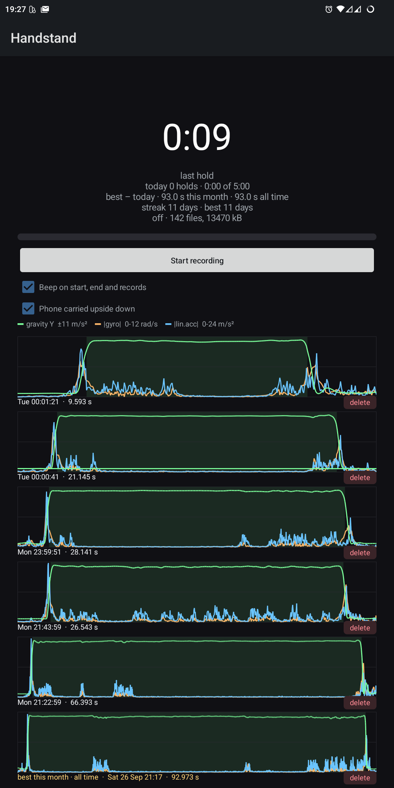
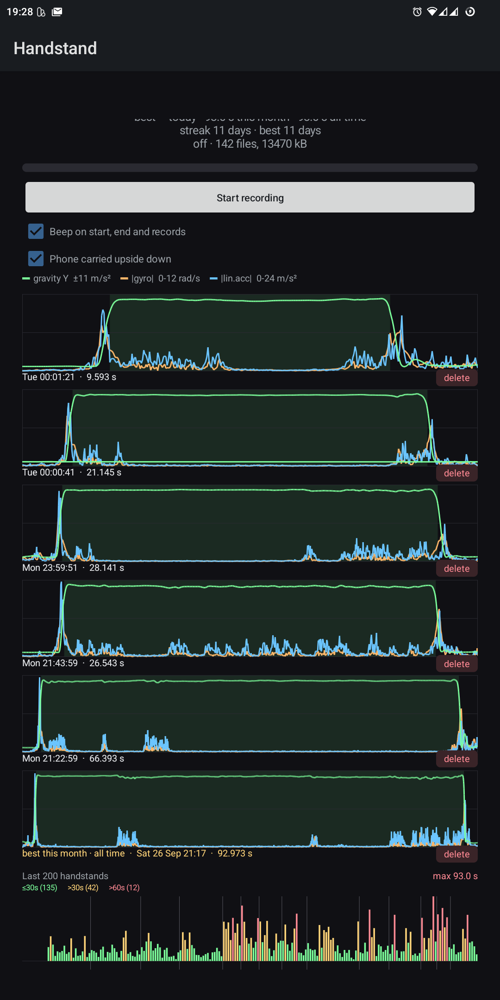

# 🤸 Handstand Timer

A tiny Android app that notices when you're upside down and times it. It runs as a
foreground service, watches the phone's gravity sensor, and starts a live clock the
moment you're in a handstand — even with the screen off and the phone in a pocket.

## ✨ What it does

- **Detects a handstand from the gravity vector.** No camera, no network, no
  account — just the accelerometer/gravity sensor, sampled continuously by a
  foreground service so it keeps working with the screen off.
- **Live timer**, with optional audible ticks every 10 seconds and a start/end
  beep (off by default).
- **Daily goal and streak.** A progress bar for a daily hold-time target, plus
  the current and best streak of days that reached it.
- **Records**: best hold of today, this calendar month, and all time.
- **A chart of recent holds** — the actual gravity/gyroscope/acceleration curves
  around each one, not just the number — plus a compact 200-hold history bar
  colored by duration.
- **A read-only interface for other apps**: a `ContentProvider` exposing today's
  progress and a `BroadcastReceiver` to start/stop/toggle recording, so a
  home-screen widget or shortcut can drive it.
- Small on purpose: pure Java, no build system beyond one shell script, no
  third-party libraries, roughly 25 KB.

## 🤝 Contributing

Issues and pull requests are welcome — please read [CONTRIBUTING.md](CONTRIBUTING.md)
first, in particular the scope below.

## 📸 Screenshots

<p float="left">
  
  
</p>

*Real screenshots from a phone. The hold times and sensor curves are real measurements.*

## 🎯 Scope

Handstand Timer is a focused handstand timer: **detecting handstands from the
phone's sensors, timing them, and keeping the history and stats of your holds.**
Changes that make detection more reliable, timing more accurate or the history more
useful are in scope; general fitness tracking, other exercises, accounts, cloud sync,
ads or analytics are not.

What it's good at:

- Timing a handstand practice session while the phone rides along in a pocket.

What it deliberately doesn't do:

- **Single-signal detection.** It decides "upside down" from the gravity vector
  crossing a threshold, gated by "was standing upright just before" to rule out
  the obvious false positive (pocketing the phone top-first). There's no
  step-counter veto or landing-spike confirmation yet — see the source for the
  exact thresholds.
- **No cloud sync, no backup, no accounts.** Everything lives in the app's own
  storage on the device; there's a raw, gzip-compressed sensor log alongside the
  detected holds, readable over USB without root, for anyone who wants to look
  at what the detector saw.
- **No crash reporting or telemetry** of any kind in this build.
- Tested mainly on one Android 14/15 device; sensor sets and rates vary by
  phone, so results elsewhere may vary.

## 📦 Requirements

- Android 14 (API 34) or newer.
- A phone with an accelerometer and gravity sensor (essentially all of them).
- The app asks for the activity-recognition and notification permissions it
  needs to run as a foreground service; nothing else.

## 📥 Install and updates

Grab the APK from **[GitHub Releases](https://github.com/jarvis-jhk/handstand/releases)**.

The releases are also built to auto-update through
[Obtainium](https://github.com/ImranR98/Obtainium):

[**➕ Add to Obtainium**](https://apps.obtainium.imranr.dev/redirect?r=obtainium://add/https://github.com/jarvis-jhk/handstand)

or open Obtainium yourself and paste in the repo URL:
`https://github.com/jarvis-jhk/handstand`

The app's package id is `org.handstandtimer.app`, distinct from any other build of this
project, so it installs side by side without conflicts.

## 🛠️ Build from source

No Gradle, no Android Studio project required — one script does everything:

```sh
git clone https://github.com/jarvis-jhk/handstand.git
cd handstand
./build.sh
```

`build.sh` downloads a JDK and the Android command-line build tools into
`.tools/` on first run (nothing installed system-wide), compiles the app with
`javac` + `d8`, and signs the APK with a disposable keystore it generates the
first time it's needed (`keystore.jks`, password `android`). The result is
`handstand.apk` in the repo root.

For an offline F-Droid build, supply JDK 17 and an Android SDK containing build-tools
35.0.0 and platform android-35. No downloads or signing key are needed:

```sh
JAVA_HOME=/path/to/jdk17 ANDROID_SDK_ROOT=/path/to/sdk UNSIGNED=1 VERSION_CODE=32 ./build.sh
```

The aligned unsigned result is also `handstand.apk`. `VERSION_CODE` overrides the
tag or exported default; it must be a positive integer. `VERSION_NAME` can also be
overridden. With identical source, version and toolchain, unsigned builds are
byte-identical across directories. Release v32 or later is the first to use this
reproducible packaging.

## 🚀 Releases

A release is a tag `vN`, where `N` is the APK's `versionCode` and has to be larger
than every earlier release (Obtainium compares exactly that number). Pushing such a tag
runs the release workflow, which waits for a maintainer's approval, signs the APK with
the project's stable key and attaches it to the release as `handstand.apk`. Releases
are made by hand after review, never automatically.

## 📄 License

Handstand Timer is distributed under the GNU General Public License version 3 (GPL-3.0-only); see [LICENSE](LICENSE).
